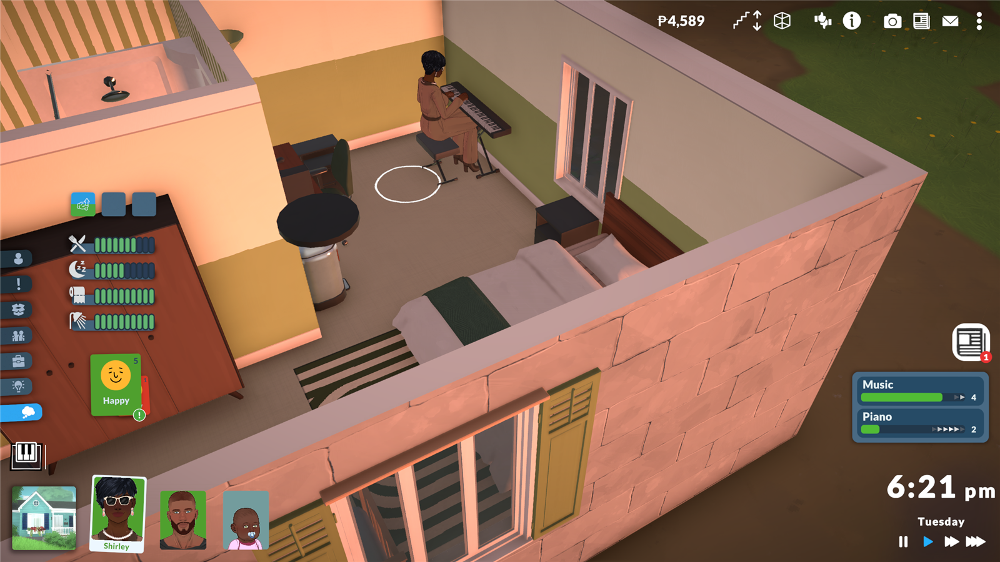
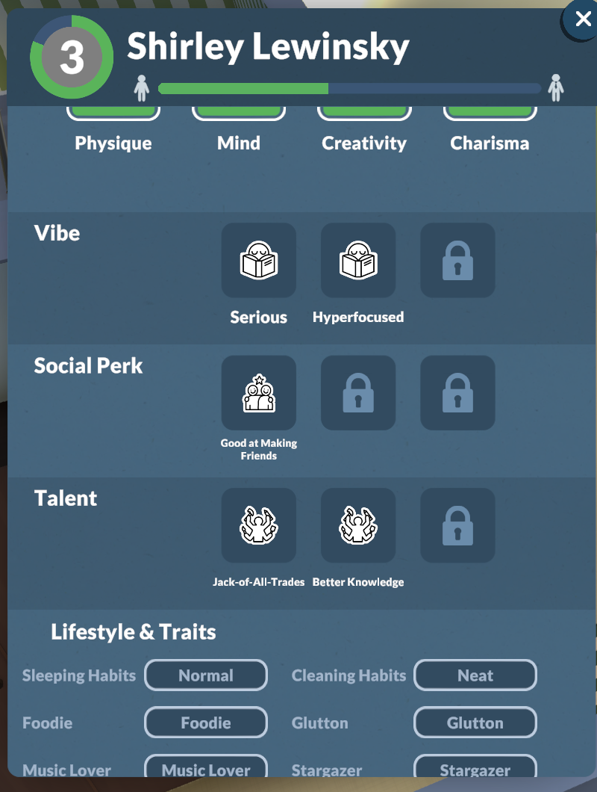

# ParaTraits: Sims-style traits for Paralives

14 new traits you can give any Para for more individuality. Each one changes what they like to do, how they feel about it, and adds spontaneous little quirks.

It is a plain content mod made with the game's own mod format: no BepInEx and no installer.



## Download
- **Steam Workshop:** [ParaTraits - Sims-style Traits](https://steamcommunity.com/sharedfiles/filedetails/?id=3838765679). Just subscribe.
- **Manual:** copy the `ParaTraits_….mod` folder from [Releases](../../releases) into `%USERPROFILE%\AppData\LocalLow\Paralives\Paralives`.

## How to use
Open a Para's personality in the Para creator. The **Lifestyles** section is now **Lifestyle & Traits**, with a switch for each new trait. Turn on as many as you like.

## The traits


| Trait | Likes doing | Feels | Spontaneous quirk | Perk |
|---|---|---|---|---|
| Foodie | cooking | Happy after meals, Inspired cooking | | learns Cooking faster |
| Glutton | snacks, leftovers | Happy after eating | snacks without being hungry | gets hungry faster |
| Gym Rat | every workout (less TV) | Happy after exercise | flexes, push-ups anywhere | learns Exercising faster |
| Couch Potato | TV, daydreaming (less exercise) | Happy after TV, Uncomfortable after exercise | zones out | |
| Lazy | naps (avoids chores, exercise) | Uncomfortable after chores | random naps | tires out faster |
| Music Lover | music, piano, guitar, dancing | Happy after music | puts music on | learns Piano and Guitar faster |
| Artsy | painting, drawing | Inspired after painting | doodles | learns Painting faster |
| Techie | coding, design, phone games | Happy after computer time | phone games, social media | learns Programming faster |
| Stargazer | the telescope | Inspired after stargazing | telescope at night | learns Astronomy faster |
| Nature Lover | flowers, walks, digging | Happy after fresh air | digs in the dirt, smells flowers | learns Outdoorsiness faster |
| Romantic | dancing with others | Flirty after kisses, hugs, slow dances | daydreams about love | |
| Hot-Headed | kicking things | randomly Angry now and then | kicks something | |
| Social Butterfly | chatting | Happy in company | starts conversations | |
| Loner | daydreaming (avoids chatting) | Uncomfortable in groups | mirror pep talks | |

The new feelings show up by name in each Para's emotion breakdown.

## How it works (for modders)
`build_mod.py` holds every trait as data and writes the mod's `Settings/*.setting` files as diffs in the game's manifest format (`@GUID` adds an element, `gGUID` edits an existing one), so nothing from the base game is copied:
- **Personalities:** each trait is a toggle in the Lifestyles category, which is the section the creator draws toggle traits in.
- **Autonomy:** score modifiers on existing idle activities (trait present → +/- score), plus new trait-gated "quirk" activities cloned from game activities with a cooldown and a random chance.
- **BrainLogic:** trigger → *if has trait* → outcome rules: moodlets after actions, while in a group, or on random hourly chances; permanent skill-learning perks; extra need decay.
- **StatusEffects:** the moodlets and perks. **Translations:** all names, plus renaming the section.

IDs are derived from names, so rebuilding never changes them and saves keep working. Rebuild with:

```bash
python build_mod.py out
```

It reads the installed game's `Main.mod/Settings` to resolve activity and action names (set `PARALIVES_SETTINGS` if the game is elsewhere). Made for Early Access 0.1.9b. Not affiliated with Paralives Studio.
